# SGameStudio: Comprehensive System Architecture

## 1. Executive Summary & Core Architectural Tenets

**SGameStudio** is an open-source, desktop-and-server software suite designed to unify the four fragmented stages of indie and AA game asset development into a single, cohesive workflow:
1. **2D Vector Drafting, Rigging & Animation**
2. **3D Intuitive Modeling, Rigging & Animation**
3. **Sound Effects, Vocals & Music Production**
4. **Game Asset Assembly & Multi-Engine Export**

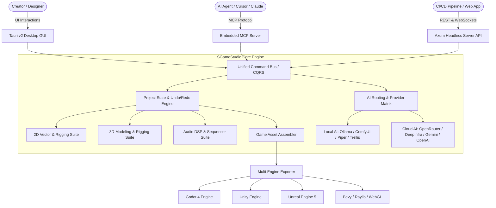

### The Universal Command Bus Pattern (CQS / CQRS)
To ensure that **every feature operable by a human is 100% controllable by AI, MCP, or REST API**, the studio does not bind business logic directly to UI event handlers. Instead:
- Every action (drawing a path, extruding a 3D face, adding a bone, generating a sound effect, binding an animation clip) is encapsulated as an **Atomic Command** conforming to the `IStudioCommand` interface.
- Commands are dispatched through a **Unified Command Bus**.
- The Command Bus handles validation, execution, state mutation, undo/redo history stacks, telemetry, and broadcasting updates to the GUI, WebSocket clients, and MCP subscribers.
- Result: An AI agent issuing an MCP tool call (`sgame_extrude_3d_face`) invokes the exact same command object as a user clicking the "Extrude" button in the 3D viewport.

---

## 2. Technology Stack & Framework Justification

Every library, engine, and dependency chosen for SGameStudio is 100% free and open-source (MIT, Apache-2.0, BSD-3-Clause, or GPL-3.0 compatible):

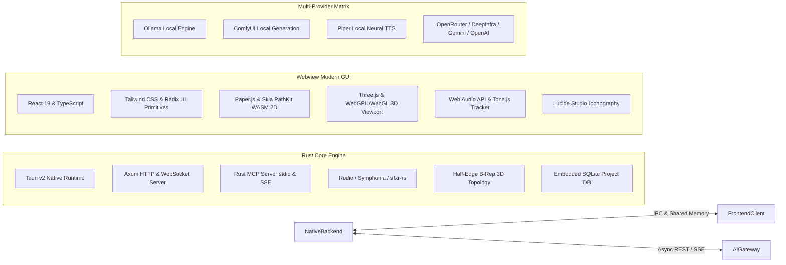

### 1. Desktop Shell: Tauri v2 (Rust)
- **Why over Electron?** Tauri v2 produces binaries under 30MB (compared to Electron's 150MB+), consumes ~80% less idle RAM, boots in under 400ms, and provides a multi-threaded Rust backend for intensive tasks like 3D mesh processing, audio synthesis, file I/O, and server execution.
- **Cross-Platform**: Compiles natively to Windows (`.exe` / `.msi`) and Linux (`.AppImage` / `.deb` / Flatpak).

### 2. Frontend Framework: React 19 + TypeScript + Vite + Tailwind CSS
- **Modern UI Ergonomics**: React 19 with Server/Client Components, concurrent rendering, and hooks enables real-time high-refresh UI updates (60/120 FPS timeline scrubbing).
- **Design System**: Tailwind CSS paired with Radix UI headless components provides accessibility, keyboard navigation, and instant theme swapping (Dark/Light/Cyberpunk).

### 3. 2D Vector & Canvas Engine: Skia PathKit (WASM) + Paper.js + PixiJS
- **Boolean Geometry**: Skia's PathKit compiled to WebAssembly provides rock-solid, production-grade boolean path operations (Union, Difference, Intersection, XOR) with zero numerical degeneracy.
- **Deformation**: PixiJS / WebGL custom mesh deformation shaders allow arbitrary 2D polygon skinning driven by skeletal bone hierarchies.

### 4. 3D Viewport & Dual-Modeling Kernel: Three.js + WebGPU + libdust3d + Custom Half-Edge B-Rep
- **Viewport**: Three.js WebGPU/WebGL renderer delivers real-time PBR shaders (Roughness/Metalness), directional cascaded shadow maps, bloom, ambient occlusion, and skeletal animation playback.
- **Node-to-Mesh Kernel (`libdust3d`)**: Built-in Rust/WASM integration of Dust3D's open-source (MIT) mesh generator. Transforms simple 3D skeleton node graphs into smooth, watertight, manifold meshes with **inherent auto-rigging and automated UV unwrapping**.
- **Topology Engine (Wings3D-style)**: A custom Half-Edge B-Rep (Boundary Representation) data structure maintains vertex, edge, and face relationships to support interactive modeling operations (Extrude, Inset, Bevel, Loop Cut, Knife) without mesh corruption.

### 5. Audio Synthesis & Sequencer: Web Audio API + Rust Rodio + sfxr DSP
- **Zero Latency**: Real-time procedural sound effect generation using the classic `sfxr` sound-synthesis algorithm ported to Rust and WebAudio DSP nodes.
- **Neural Speech**: Built-in integration with Piper TTS and Kokoro for offline high-quality neural voice synthesis, plus pitch/formant benders.
- **Tracker**: 16-channel step sequencer supporting soundfonts, synth patches, sample playback, and MIDI export.

### 6. Headless Server & Model Context Protocol (MCP)
- **Axum Web Server**: High-throughput asynchronous Rust HTTP server powering the REST API and WebSocket events when running in server mode (`--server`).
- **Embedded MCP Server**: Implements the official Model Context Protocol over `stdio` and HTTP/SSE, exposing every studio operation as a discoverable tool for AI coding agents.

---

## 3. Subsystem 1: Core Engine & Unified Command Bus

The Core Engine coordinates application lifecycle, document state, undo/redo buffers, project persistence, and external messaging.

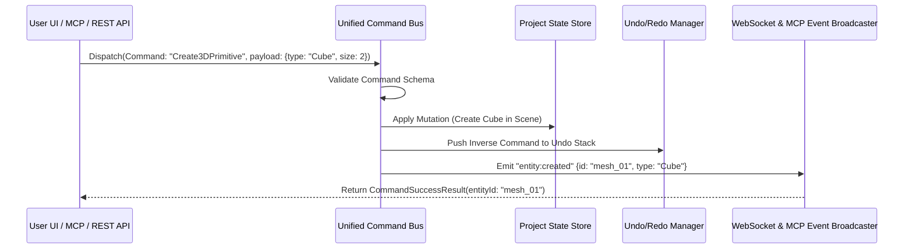

### Project File Specification (`.sgsproj`)
Projects are saved as a high-performance ZIP archive containing:
```text
my_game_character.sgsproj (ZIP format)
├── project.json            # Project metadata, engine target settings, theme, version
├── scene2d/
│   ├── vectors.svg         # Clean layered SVG vector artwork
│   ├── rig2d.json          # 2D bone hierarchy, constraints, and vertex weights
│   └── anims2d.json        # 2D animation clips and dopesheet keyframes
├── scene3d/
│   ├── model.glb           # 3D mesh geometry with vertex attributes & materials
│   ├── rig3d.json          # 3D Armature bone hierarchy and skin weights
│   └── anims3d.json        # 3D skeletal animation clips
├── audio/
│   ├── sfx/                # Procedural synth configs and rendered WAV files
│   ├── vocals/             # TTS transcripts, voice model configs, audio files
│   └── music/              # Tracker pattern data, instruments, rendered tracks
├── entities/
│   └── character.asset.json# Game Asset Blueprint binding visual + anims + audio + collision
└── thumbnails/
    └── preview.webp        # Rendered studio thumbnail
```

---

## 4. Subsystem 2: AI Routing Matrix & Intelligence Engine

SGameStudio features an intelligent, multi-tiered AI Gateway that decouples the creative task from any single AI vendor.

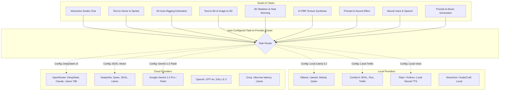

### Granular Routing Configuration
Users can configure distinct AI providers and models per function in `settings.json`:
```json
{
  "ai_routing": {
    "chat_assistant": { "provider": "deepinfra", "model": "meta-llama/Meta-Llama-3.1-70B-Instruct" },
    "vector_generation": { "provider": "openrouter", "model": "anthropic/claude-3.5-sonnet" },
    "model_3d_generation": { "provider": "comfyui_local", "endpoint": "http://127.0.0.1:8188", "workflow": "trellis_text_to_3d" },
    "texture_pbr_generation": { "provider": "deepinfra", "model": "stabilityai/stable-diffusion-xl-base-1.0" },
    "auto_rigging_heuristic": { "provider": "gemini", "model": "gemini-1.5-flash" },
    "audio_sfx_prompt": { "provider": "openrouter", "model": "deepseek/deepseek-chat" },
    "vocal_speech_tts": { "provider": "local_piper", "voice": "en_US-lessac-medium" },
    "music_composition": { "provider": "local_audiocraft", "model": "musicgen-small" }
  }
}
```

### Interactive Studio Chat Agent
- Resides in a collapsible right-hand dock in the GUI.
- Has live bidirectional access to the current scene state (selected objects, active timeline frame, active 2D/3D viewport canvas).
- Can capture viewport screenshots and submit them to multimodal models (Gemini, Claude, GPT-4o) for real-time visual critique and automated corrections.
- Equipped with full tool-calling capabilities to execute any command on the Command Bus on the user's behalf.

---

## 5. Subsystem 3: 2D Vector & Rigging/Animation Suite

The 2D Studio provides vector drawing, character rigging, and timeline animation tailored for 2D game developers.

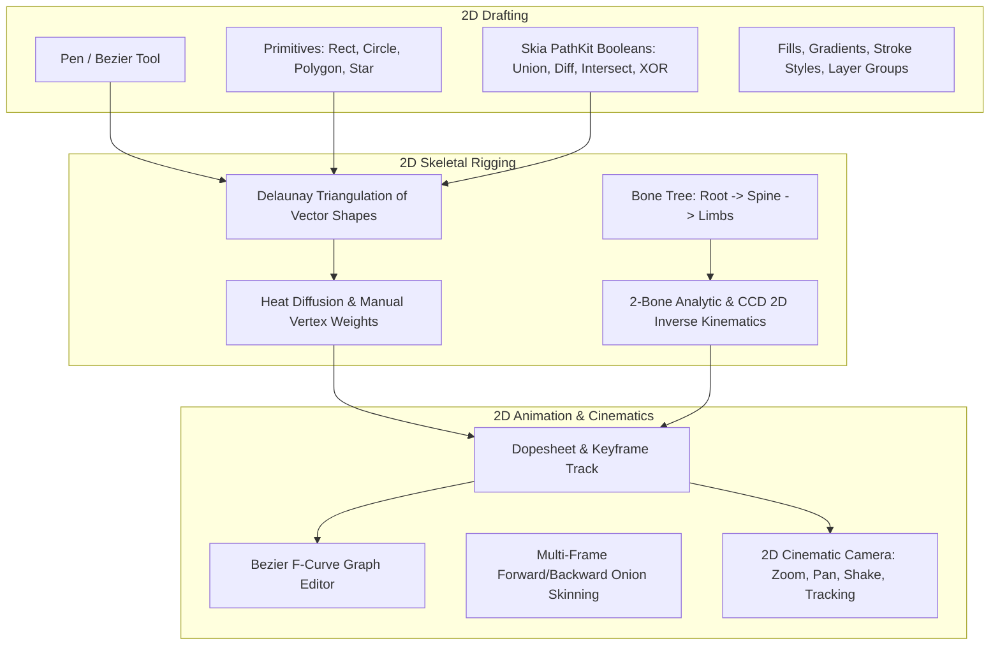

### Key Capabilities
1. **Vector Drawing**:
   - Bezier pen tool with auto-snapping, corner rounding, and symmetry mirroring.
   - Non-destructive Boolean Operations powered by Skia PathKit (WASM).
   - SVG 1.1/2.0 import and clean, optimized export without redundant tags.
2. **2D Skeletal Rigging**:
   - Click-to-create bone chains with automatic parenting.
   - Automatic Delaunay triangulation turns smooth vector contours into deformable 2D triangle meshes.
   - Smooth heat diffusion weights automatically bind vector vertices to nearby bones.
   - 2-bone analytical IK (Inverse Kinematics) with pole targets for limbs (arms, legs, tails).
3. **AI 2D Auto-Rigging**:
   - Vision AI analyzes the 2D character silhouette, predicts key joint locations (head, neck, shoulders, elbows, wrists, hips, knees, ankles), inserts standard biped/quadruped bones, and calculates skinning weights in one second.
4. **Animation & Cinematics**:
   - Standard action clips: `Idle`, `Walk`, `Run`, `Attack`, `Hurt`, `Die`.
   - Dopesheet view for timing adjustments and Graph Curve view for interpolation easing.
   - 2D Cinematic Camera track for panning, zooming, and cutscene sequencing.

---

## 6. Subsystem 4: 3D Modeling, Rigging & Animation Suite (Dual-Engine: Dust3D + Wings3D)

The 3D Studio solves 3D game asset creation through an innovative **Dual-Modeling Paradigm** that combines the lightning-fast, organic creature generation of **Dust3D** with the precision hard-surface box modeling of **Wings3D / SketchUp**.

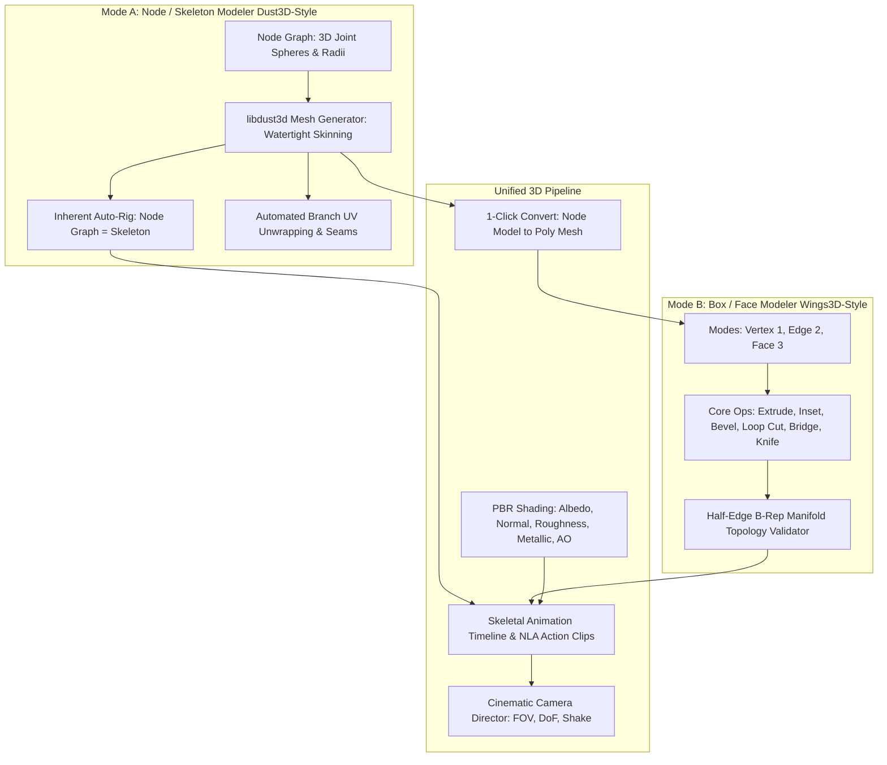

### Key Capabilities

#### 1. Mode A: Node / Skeleton-First Modeling (Dust3D-Style)
- **Instant Organic Modeling**: Instead of manually pushing vertices, creators place **3D nodes** (points with a radius) in space, connecting them like a skeleton (e.g., Head $\to$ Neck $\to$ Torso $\to$ Limbs).
- **Automated Watertight Skinning (`libdust3d`)**: The in-process engine generates a seamless, manifold, quad/triangle mesh wrapped around the nodes in real time.
- **Inherent Auto-Rigging**: Because the mesh is generated directly from a hierarchical node tree, **the model is already rigged the instant it is generated**. No separate bone placement or manual vertex weight painting is required for base meshes.
- **Automated UV Unwrapping**: Generates clean, non-overlapping UV islands partitioned logically by body branch (head, torso, limbs).
- **The Ultimate AI Modeling Primitive**: Unlike raw polygonal meshes where LLMs struggle with vertex-index topologies, an AI agent can build a complete, detailed 3D monster or character using a simple JSON node graph:
  ```json
  [
    { "name": "Head", "radius": 0.25, "position": [0, 1.8, 0] },
    { "name": "Torso", "radius": 0.38, "position": [0, 1.2, 0], "parent": "Head" },
    { "name": "Arm_L", "radius": 0.12, "position": [-0.5, 1.1, 0], "parent": "Torso" }
  ]
  ```

#### 2. Mode B: Box & Precision Modeling (Wings3D / SketchUp-Style)
- **Hard-Surface Perfection**: Designed for weapons, armor, shields, sci-fi props, vehicles, and architecture.
- **Three Core Selection Modes**: Vertex (`1`), Edge (`2`), Face (`3`), with loop and ring multi-selection.
- **Immediate Contextual Operators**:
  - `E` (Extrude along face normal or axis)
  - `I` (Inset face with depth control)
  - `B` (Bevel edge or face loop)
  - `R` (Loop Cut and slide)
  - `K` (Knife cut across arbitrary edges)
  - `Subdivide` (Catmull-Clark / Loop smoothing)
- **Watertight Manifold Engine**: Validates topology using Euler-Poincaré invariants in real time to prevent broken geometry.

#### 3. Seamless Hybrid Conversion
- Creators can **sketch an organic character base in 60 seconds using Mode A (Dust3D)**, click **"Bake to Polygon Mesh"**, and seamlessly switch to **Mode B (Wings3D)** to extrude armor plates, bevel weapon edges, or cut mechanical details into the mesh.

#### 4. AI 3D Generation & PBR Material Synthesis
- Integrated text-to-3D pipelines (Trellis, TripoSR, Hunyuan3D).
- Automatic generation of complete PBR material maps (Albedo, Normal map, Roughness, Metallic, Ambient Occlusion).

#### 5. Animation & Cinematic Camera Director
- Skeletal timeline supporting standard animation clips (`Idle`, `Walk`, `Run`, `Attack`, `Death`).
- Cinematic Camera Sequencer with keyframable focal length, depth of field, and camera tracking.

---

## 7. Subsystem 5: Audio Studio (SFX, Vocals, Music)

The Audio Studio provides a complete sound design and music workstation tailored for game audio assets.

```mermaid
graph TD
    subgraph Sound Effects Studio SFX
        SFXR[Procedural Synth Engine: sfxr/chip-synth]
        FoleyDSP[Noise Generators, Envelopes, Pitch Sweeps, Distortion, Reverb]
        AISFX[Prompt-to-SFX: AudioCraft / Stable Audio / OpenRouter]
        SFXPresets[Presets: Jump, Laser, Explosion, Hit, Coin, Powerup, Footstep]
    end

    subgraph Vocals Studio
        NeuralTTS[Offline Neural TTS: Piper / Kokoro]
        CloudTTS[Cloud TTS Connectors: OpenAI, DeepInfra, ElevenLabs]
        VoiceFX[Modulation DSP: Robot, Alien, Monster, Radio Filter, Pitch Shifter]
    end

    subgraph Music Studio
        TrackerDAW[16-Track Pattern Sequencer / Tracker]
        Soundfonts[General MIDI / FOSS Soundfonts & Wavetable Synth]
        AIMusic[Prompt-to-Music: MusicGen / AudioCraft]
        MusicArranger[Intro, Verse, Chorus, Outro Pattern Arranger]
    end

    SFXR --> AudioMixer[Master Audio Mixer & Export]
    FoleyDSP --> AudioMixer
    AISFX --> AudioMixer
    NeuralTTS --> AudioMixer
    VoiceFX --> AudioMixer
    TrackerDAW --> AudioMixer
    AIMusic --> AudioMixer
```

### Key Capabilities
1. **Procedural SFX Synthesizer**:
   - Classic retro & modern game sound generator based on `sfxr` / `jsfxr` with real-time waveform tweaking (Square, Sawtooth, Sine, Triangle, Noise).
   - One-click instant generators: `Laser/Shoot`, `Explosion`, `Powerup`, `Hit/Hurt`, `Jump`, `Blip/Select`, `Coin/Pickup`.
   - Advanced DSP rack: Lowpass/Highpass filters, Flanger, Bitcrusher, Overdrive, Reverb.
2. **Vocal Acting & Speech Engine**:
   - Offline, privacy-first text-to-speech powered by Piper TTS (runs on CPU in <100ms).
   - Voice character modifier: Transform normal speech into an orc grunt, robot synth, radio transmission, or alien whisper.
3. **Music Tracker & AI Composer**:
   - Intuitive pattern-based step sequencer (similar to MilkyTracker/FamiTracker, but with modern piano-roll UX).
   - AI Music Generation: Prompt-driven background looping music (e.g., "8-bit dungeon battle with fast arpeggios") using MusicGen models.
4. **Audio Formats**: Export to WAV (16/24-bit lossless), OGG Vorbis (optimized for Godot/Unity game loops), MP3, FLAC, and MIDI.

---

## 8. Subsystem 6: Game Asset Assembler & Multi-Engine Exporter

The Game Asset Assembler bridges the gap between raw art/audio files and the final game engine.

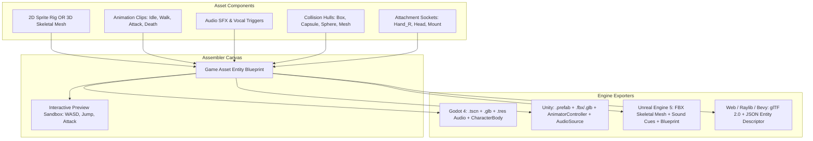

### The Interactive Test Sandbox
Inside the studio, creators can press **Test Play** to control their character in a real-time 2D or 3D sandbox:
- Use standard WASD + Space controls to run and jump.
- Animation states transition dynamically based on velocity and ground contact.
- Audio event markers trigger in sync with animation frames (e.g., footstep sound at frame 14 of `Walk`, sword slash at frame 6 of `Attack`).
- Collision boundaries display with debug wireframes.

### Engine Export Specifications
- **Godot 4 Exporter**: Generates a clean `.tscn` node tree with a `CharacterBody2D` or `CharacterBody3D`, attached `CollisionShape`, `AnimationPlayer` populated with tracks, and `AudioStreamPlayer` nodes hooked to animation method call tracks.
- **Unity Exporter**: Generates a `.prefab` with a configured `Animator Controller` containing state machine transitions (Idle $\leftrightarrow$ Walk $\leftrightarrow$ Attack), `CapsuleCollider`, and `AudioSource` components.
- **Unreal Engine 5 Exporter**: Exports standard skeletal FBX with animation sequences, physics asset definitions, and Sound Cues.

---

### 8.3 Automated Multi-Engine & Language Code Generator

Exporting 3D models or 2D sprites is only half the journey; integrating them into gameplay code traditionally requires writing boilerplate movement, animation state machines, input listeners, and sound event hooks. 

SGameStudio features an integrated **Automated Code Generator** in the Game Asset Assembler that inspects the Entity Blueprint (animation clip names, audio markers, collision dimensions, socket joints) and writes clean, idiomatic, ready-to-run character controllers and entity scripts.

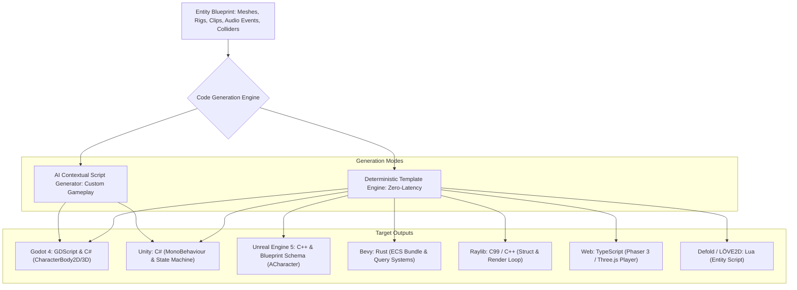

#### 1. Supported Engines & Programming Languages

| Engine / Framework | Programming Language | Generated Script Architecture |
| :--- | :--- | :--- |
| **Godot 4** | **GDScript** (Standard) | `CharacterBody2D` / `CharacterBody3D` controller with physics movement (`move_and_slide()`), state enum (`IDLE`, `RUN`, `ATTACK`, `JUMP`), Coyote time, `AnimationPlayer` transitions, and audio stream playback. |
| **Godot 4 (.NET)** | **C#** | Strongly-typed Godot C# class with partial class definitions, exported properties, and typed signal connections. |
| **Unity** | **C#** | `MonoBehaviour` controller supporting both New Input System and Legacy Input, `Animator` state hashes (`Animator.StringToHash`), ground raycasts, and `AudioSource` playback. |
| **Unreal Engine 5** | **C++** | Clean `ACharacter` derived header (`.h`) and implementation (`.cpp`) with `UCharacterMovementComponent`, Enhanced Input Action bindings, and AnimMontage hooks. |
| **Bevy (Rust)** | **Rust** | Idiomatic Bevy ECS components (`Player`, `Velocity`, `GroundDetection`), animation clip queries, and keyboard input reader system. |
| **Raylib** | **C99 / C++** | Minimal, self-contained struct and update/draw loop loading the model or spritesheet with `UpdateModelAnimation()` and `PlaySound()`. |
| **Web / HTML5** | **TypeScript** | Clean ES6 class with event-driven keyboard controls, Three.js or Phaser 3 rendering, and Web Audio API playback. |
| **Defold / LÖVE** | **Lua** | Clean table-based entity controller with state machine and physics update callbacks. |

#### 2. Deterministic vs. AI-Assisted Generation
- **Deterministic Templates**: Instantaneously generated upon export without contacting an LLM. Guarantees bug-free, zero-latency starter scripts mapped 1:1 to the blueprint's actual animation names (`Idle`, `Walk`, `Slash`) and audio triggers.
- **AI-Assisted Custom Gameplay Generator**: Creators can prompt the AI inside the in-app Code tab:  
  *Example*: *"Generate a wall-climbing and double-jump mechanic for this character in Godot 4 GDScript, with a stamina meter."*  
  The AI receives the full blueprint context (collision dimensions, bone sockets, animation clips) and produces complete, customized code ready to paste or export.

#### 3. In-App Code Viewer & Exporter
- The Game Asset section features a dedicated **Code Preview Tab** with Monaco/Prism syntax highlighting.
- Features one-click **Copy to Clipboard**, **Save As Script File**, or automatic inclusion into the engine export folder (e.g. exporting `PlayerController.gd` directly into the Godot project folder).

---

## 9. Subsystem 7: Zero-Terminal One-Click Launch & Embedded Service Supervisor

A foundational design requirement of SGameStudio is that **the user must be able to launch and operate the entire studio with a single click**—without flashing command-prompt windows, managing Python virtual environments, or juggling background terminal services.

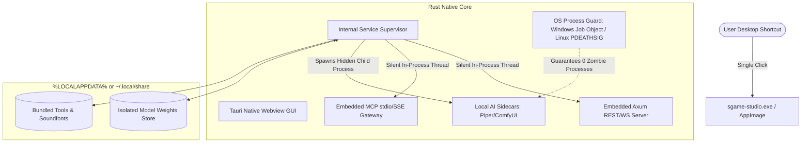

### 9.1 Zero-Terminal Architecture (No Console Windows)
1. **Windows Subsystem Flag**: The Rust binary is compiled with `#![windows_subsystem = "windows"]`. Launching the executable immediately displays the studio splash screen and UI with **zero Command Prompt or PowerShell consoles**.
2. **Hidden Child Spawning**: Any external helper processes (such as bundled audio converters or neural runtime sidecars) are spawned via Rust's `std::process::Command` using the Windows-specific flag `CREATE_NO_WINDOW (0x08000000)` and standard `stdin/stdout/stderr` piping.
3. **Automated Clean Teardown (Zero Zombie Processes)**:
   - **Windows**: All child processes are assigned to a Windows **Job Object** configured with `JOB_OBJECT_LIMIT_KILL_ON_JOB_CLOSE`. When SGameStudio is closed (even if abruptly terminated), the Windows OS kernel instantly and cleanly reaps all child processes.
   - **Linux**: Child processes are placed in an isolated process group and configured with `prctl(PR_SET_PDEATHSIG, SIGTERM)`. When the parent GUI exits, all workers shut down cleanly without leaving orphaned processes in the background.

---

### 9.2 In-App Sandboxed Model & Library Manager
No user is ever asked to open a terminal, configure `venv`, or run `pip install` / `npm install`:
- **Completely Self-Contained Storage**:
  - Windows: `%LOCALAPPDATA%\SGameStudio\sandbox\`
  - Linux: `~/.local/share/sgamestudio/sandbox/`
- **Zero System Pollution**: System `PATH`, global Python packages, and user environment variables are left completely untouched.
- **In-App One-Click Downloads**:
  - The studio UI features a built-in **Model & Asset Manager** panel.
  - Users browse models (e.g. "Piper Neural Voices", "Trellis 3D Checkpoints", "8-Bit Soundfont Library"), click **Download**, and watch a real-time progress bar.
  - The Rust backend downloads the archive via streaming HTTPS, validates the cryptographic SHA-256 checksum, unpacks it into the sandboxed directory, and hot-reloads the active AI routing registry automatically.

---

### 9.3 Flexible Execution Topologies

While single-click desktop operation is the default, SGameStudio seamlessly supports headless automation when launched via command-line arguments:

| Mode | Invocation | Description |
| :--- | :--- | :--- |
| **Primary Desktop GUI** *(Default)* | Double-click desktop icon or `sgame-studio` | Launches full GUI, starts embedded supervisor silently, opens studio window. |
| **Headless Studio Server** | `sgame-studio --server --port 8080` | Starts REST API & WebSocket server without a GUI window (for remote cloud hosts or game dev CI/CD pipelines). |
| **Headless MCP Agent Mode** | `sgame-studio --mcp` | Runs Model Context Protocol on `stdio` for direct pairing with Claude Desktop, Cursor, or Antigravity. |
| **Combined Server + MCP SSE** | `sgame-studio --server --port 8080 --mcp-sse` | Serves web clients, REST endpoints, and network MCP agents simultaneously. |

> **GUI mode embeds the backend.** In the desktop GUI build, the Axum REST/WS/MCP-SSE server is
> started automatically on `127.0.0.1:8080` (overridable via `SGAME_PORT`) in a background thread.
> This is why the UI's connection indicator reads "connected" and the Settings dialog can save AI
> provider API keys without running a separate `--server` process. A permissive CORS layer lets the
> WebView origin talk to the loopback backend.

---

## 10. Subsystem 8: Model Context Protocol (MCP) Server Architecture

The embedded MCP server exposes three core primitives defined by the Anthropic Model Context Protocol specification:

```mermaid
graph TD
    subgraph MCP Server Endpoints
        Tools[MCP Tools: 35+ Executable Operations]
        Resources[MCP Resources: Live State & Snapshots]
        Prompts[MCP Prompts: Pre-Engineered Workflows]
    end

    subgraph External Agents
        ClaudeDesktop[Claude Desktop]
        CursorIDE[Cursor IDE / Antigravity]
        AutonomousAgents[Custom Python / TS Agents]
    end

    ClaudeDesktop <-->|stdio transport| MCP Server Endpoints
    CursorIDE <-->|stdio transport| MCP Server Endpoints
    AutonomousAgents <-->|SSE / HTTP transport| MCP Server Endpoints
```

### Categories of MCP Tools
1. **Project & Workspace**: `sgame_new_project`, `sgame_load_project`, `sgame_save_project`, `sgame_get_scene_summary`.
2. **2D Vector & Rigging**: `sgame_create_2d_shape`, `sgame_boolean_2d_paths`, `sgame_auto_rig_2d`, `sgame_create_2d_keyframe`.
3. **3D Modeling & Rigging**: `sgame_create_3d_primitive`, `sgame_extrude_3d_face`, `sgame_inset_3d_face`, `sgame_bevel_3d_edge`, `sgame_auto_rig_3d`, `sgame_create_3d_keyframe`.
4. **Audio (SFX, Vocals, Music)**: `sgame_generate_sfx_preset`, `sgame_synthesize_vocal_tts`, `sgame_compose_music_pattern`.
5. **AI Pipeline Triggers**: `sgame_ai_prompt_to_vector`, `sgame_ai_prompt_to_3d`, `sgame_ai_generate_pbr_textures`, `sgame_ai_prompt_to_sfx`.
6. **Asset Assembly & Export**: `sgame_create_game_entity`, `sgame_bind_audio_to_animation_frame`, `sgame_export_to_engine`.

*(See `docs/MCP_AND_API_SPECIFICATION.md` for complete JSON schemas of all tools).*

---

## 11. Subsystem 9: Quality Assurance & Automated Testing Architecture

To guarantee rock-solid stability across Windows and Linux, SGameStudio incorporates an automated testing pyramid:

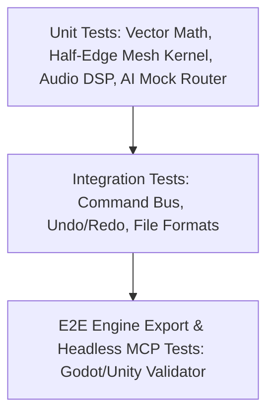

1. **Unit Testing**:
   - 2D: Vector intersection algorithms, Skia WASM boolean output validation, Bezier path length calculations.
   - 3D: Half-edge topology manifold invariant checks (Euler-Poincaré formula $V - E + F = 2(1 - g)$), vertex normal recalculations, heat skinning weight normalization ($\sum w_i = 1.0$).
   - Audio: DSP buffer sanity, clipping detection, sfxr parameter ranges, WAV header integrity.
2. **Integration Testing**:
   - Command Bus serialization & inverse command generation (Undo/Redo symmetry).
   - `.sgsproj` zip archive serialization and round-trip deserialization.
3. **End-to-End (E2E) Headless CLI Verification**:
   - A dedicated test command (`sgame-studio test`) spins up a headless instance, triggers asset creation via MCP tools, exports to Godot 4 and Unity formats, and validates the exported files against target engine schemas.

---

## 12. Subsystem 10: Themes, Workspace Customization & Settings

### Visual Themes
SGameStudio ships with four built-in high-fidelity themes defined via CSS design tokens:
- **Obsidian Dark** *(Default)*: Base background `#0d1117`, surface `#161b22`, border `#30363d`, primary accent `#7c3aed` (electric violet), text `#f0f6fc`.
- **Cyberpunk Neon**: Base background `#0a0a14`, surface `#121226`, border `#2c2c54`, primary accent `#00f0ff` (cyan), secondary `#ff0055` (hot pink).
- **Paper Light**: Base background `#f8fafc`, surface `#ffffff`, border `#e2e8f0`, primary accent `#2563eb` (royal blue), text `#0f172a`.
- **High-Contrast Pro**: Base background `#000000`, surface `#111111`, border `#ffffff`, primary accent `#ffff00` (safety yellow), text `#ffffff`.

### Settings Schema (`providers.json` + environment variables)
AI provider API keys are stored obfuscated at rest (not plaintext) and are never returned unmasked to the UI:
- **Windows**: `%APPDATA%\sgamestudio\providers.json`
- **Linux**: `~/.local/share/sgamestudio/providers.json` (APPDATA fallback / XDG-like)

Keys can instead be supplied via environment variables, which always win and are
never written to disk:
- `SGAME_OPENROUTER_KEY`, `SGAME_DEEPINFRA_KEY`, `SGAME_OPENAI_KEY`,
  `SGAME_ANTHROPIC_KEY`, `SGAME_GEMINI_KEY`

Supported configurations include:
- AI provider API keys (obfuscated at rest; masked `sk-a••••mnop` in the UI).
- Local AI endpoints (Ollama host, ComfyUI host, Piper path).
- Default game engine export target (Godot 4, Unity, Unreal 5).
- Audio buffer size and sample rate.
- Viewport graphics settings (WebGL vs. WebGPU, shadow map resolution).

The in-app **Settings dialog** (`Settings → AI Provider API Keys`) writes keys via
`POST /api/v1/settings` (camelCase `apiKey`), and the in-app **AI Assistant**
(`ChatDock`) sends messages to `POST /api/v1/ai/chat`.
