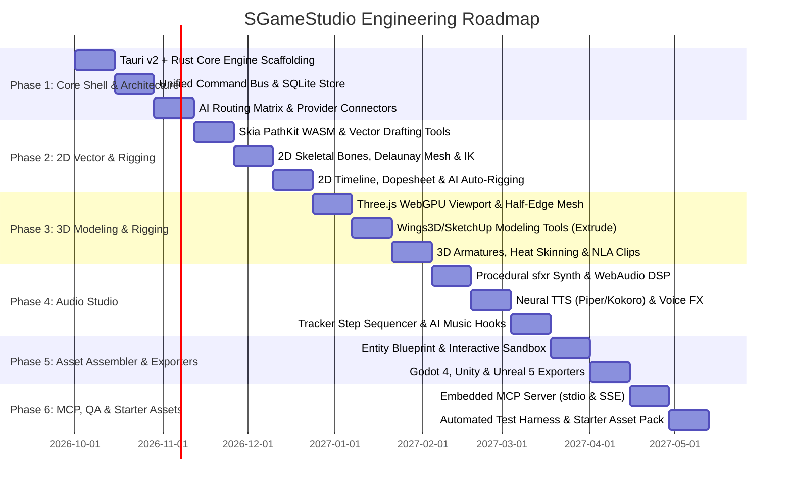
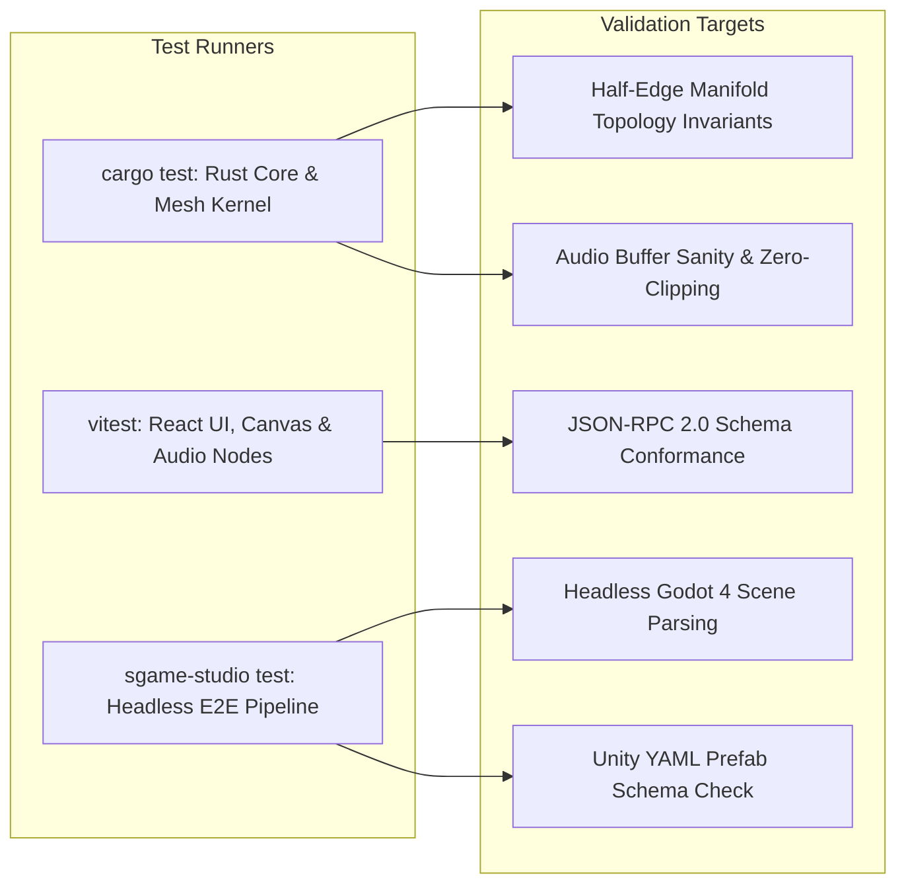

# SGameStudio: Implementation Roadmap & Engineering Plan

## 1. Engineering Principles & Milestone Overview

This implementation roadmap outlines the phased development of **SGameStudio** from initial scaffolding to a fully tested, production-grade release. Development follows these foundational rules:

1. **Strictly 100% Free & Open-Source Software (FOSS)**: Every tool, library, neural network weight, and dependency must be free of proprietary runtime licensing.
2. **Unified Command Architecture**: UI components never manipulate scene data directly; all actions flow through atomic, serializable commands on the Command Bus.
3. **Headless-First Design**: Every feature developed for the desktop GUI must run identically in headless server mode (`--server`) and via the Model Context Protocol (`--mcp`).
4. **Hermetic Automated Verification**: Every subsystem must feature unit tests and automated mock pipelines for offline CI/CD verification.



---

## 1.5 Current Status (2026-09)

Backend foundation is shipped and fully tested:

- **Milestone 1 (Core)**: Dual-mode Rust engine (Tauri GUI + headless `--server`/`--mcp`), Unified Command Bus, `.sgsproj` zip roundtrip, AI Routing Matrix + multi-provider gateway (OpenRouter / DeepInfra / OpenAI / Anthropic / Gemini / Ollama / ComfyUI / Piper / AudioCraft).
- **Milestone A (3D export)**: Real 3D geometry stored in state + exporters (OBJ / STL ASCII+binary / PLY ASCII+binary / GLB / SVG / WAV) exposed via `GET /api/v1/mesh/export`.
- **Milestone B (Settings)**: AI provider API-key storage (`%APPDATA%\sgamestudio\providers.json`, obfuscated at rest, masked in UI, `SGAME_<PROVIDER>_KEY` env override) + `GET/POST /api/v1/settings` (camelCase `apiKey`).
- **Milestone C (MCP)**: `sgame_export_asset`, `sgame_get_settings`, `sgame_save_provider_key` MCP tools.
- **Milestone D (AI chat)**: `POST /api/v1/ai/chat` runs the in-app assistant through the configured chat provider (clean `503` when no key), wired to the Settings dialog.
- **Desktop connection**: GUI mode embeds the REST/WS/MCP-SSE backend on `127.0.0.1:8080` (via `SGAME_PORT`) so the UI shows "connected" and can save keys / chat / export without a separate `--server` process.

Frontend increments shipped: editable API-key Settings dialog, real AI Assistant (ChatDock → `/api/v1/ai/chat`), 3D Export panel (OBJ/STL/GLB/PLY download), and a 2D workbench (draw tools + select/move + keyframe position timeline with playback).

**Remaining (largest gap is frontend):** full 2D rigging + tween easing + onion skin, 3D modeling/armature + IK/FK + NLA, DAW multi-track mixer + render-to-file, video/motion tab, animation workbench consolidation, in-app AI agentic tool-calling, and starter asset pack.

---

## 2. Target Project Directory Structure

```text
SGameStudio/
├── Cargo.toml                     # Rust workspace configuration
├── package.json                   # Web frontend workspace configuration
├── README.md                      # Project overview and quickstart
├── docs/                          # Architecture, MCP, and Roadmap specifications
│   ├── ARCHITECTURE.md
│   ├── MCP_AND_API_SPECIFICATION.md
│   ├── IMPLEMENTATION_ROADMAP.md
│   ├── USER_MANUAL_ELI5.md        # User-facing plain-English manual
│   └── DEVELOPER_GUIDE_ELI5.md    # Contributor plain-English development guide
├── src-tauri/                     # Tauri v2 Rust native desktop & headless backend
│   ├── Cargo.toml
│   ├── tauri.conf.json            # Window configurations, permissions, icons
│   └── src/
│       ├── main.rs                # Entry point: flags parser (--server, --mcp, GUI)
│       ├── core/                  # Unified Command Bus, Undo/Redo, Project Store
│       │   ├── command_bus.rs
│       │   ├── commands.rs
│       │   ├── state_store.rs
│       │   └── project_zip.rs
│       ├── server/                # Axum HTTP REST and WebSocket server
│       │   ├── mod.rs
│       │   ├── routes.rs
│       │   └── websocket.rs
│       ├── mcp/                   # Model Context Protocol server (stdio & SSE)
│       │   ├── mod.rs
│       │   ├── protocol.rs
│       │   ├── tools.rs
│       │   └── resources.rs
│       ├── mesh_kernel/           # Half-Edge B-Rep 3D topology data structure
│       │   ├── mod.rs
│       │   ├── half_edge.rs
│       │   └── operators.rs       # Extrude, Inset, Bevel, Subdivide
│       ├── audio_dsp/             # Rust audio synthesis and processing
│       │   ├── mod.rs
│       │   ├── sfxr_synth.rs
│       │   └── wav_encoder.rs
│       └── ai_gateway/            # Multi-provider AI router
│           ├── mod.rs
│           ├── router.rs
│           └── providers/         # Ollama, ComfyUI, OpenRouter, DeepInfra, etc.
├── src/                           # React 19 + TypeScript modern frontend
│   ├── index.html
│   ├── main.tsx
│   ├── App.tsx                    # Main Studio layout and view switcher
│   ├── index.css                  # Tailwind styles and theme token definitions
│   ├── components/                # Reusable design system components
│   │   ├── ui/                    # Buttons, Dropdowns, Sliders, Modals (Radix)
│   │   ├── dock/                  # Dockable panel manager
│   │   ├── chat/                  # AI Assistant interactive chat panel
│   │   └── settings/              # Settings & AI Provider configuration modal
│   ├── modules/                   # The 4 core studio domains
│   │   ├── studio2d/              # 2D Vector canvas, bones, and dopesheet
│   │   │   ├── canvas/
│   │   │   ├── rigging/
│   │   │   └── animation/
│   │   ├── studio3d/              # 3D Viewport, Wings3D tools, armature
│   │   │   ├── viewport/
│   │   │   ├── tools/
│   │   │   └── rigging/
│   │   ├── audio/                 # SFX generator, TTS vocals, music tracker
│   │   │   ├── sfx/
│   │   │   ├── vocals/
│   │   │   └── tracker/
│   │   └── assembler/             # Game Asset Entity Composer & Sandbox
│   │       ├── composer/
│   │       ├── sandbox/
│   │       └── exporters/
│   └── services/                  # Frontend API and MCP client bridges
│       ├── commandBridge.ts
│       ├── mcpBridge.ts
│       └── themeManager.ts
├── starter_assets/                # Bundled starter assets and templates
│   ├── 2d_pixel_knight/
│   ├── 3d_scout_bot/
│   └── audio_retro_pack/
└── tests/                         # Comprehensive automated test suites
    ├── unit/                      # Rust and TypeScript unit tests
    ├── integration/               # Command bus, undo/redo, file format roundtrips
    ├── mcp_e2e/                   # Headless MCP agent automation test suite
    └── engine_export_val/         # Godot 4 and Unity exported asset validators
```

---

## 3. Detailed Phase Breakdown

### Phase 1: Core Shell, Command Bus & AI Gateway Scaffolding
- **Milestone 1.1**: Set up Tauri v2 workspace with dual execution modes (GUI desktop window on Windows/Linux vs. headless `--server` and `--mcp` flags).
- **Milestone 1.2**: Implement the **Unified Command Bus** in Rust with serializable command packets, validation, and bi-directional state synchronization.
- **Milestone 1.3**: Implement `.sgsproj` zipped project bundle serializer and SQLite embedded metadata database.
- **Milestone 1.4**: Implement the **AI Routing Matrix**:
  - Connectors for Ollama (local), ComfyUI (local workflows), OpenRouter, DeepInfra, Google Gemini, OpenAI, Anthropic, and Groq.
  - Task-specific routing configuration (assigning model per task).
  - Built-in AI Chat Dock with streaming response, tool calling, and viewport context injection.
- **Milestone 1.5**: Implement the **Embedded Service Supervisor & Sandboxed Storage**:
  - Compile with `#![windows_subsystem = "windows"]` to ensure zero CMD/PowerShell consoles appear when launched.
  - Windows Job Object (`JOB_OBJECT_LIMIT_KILL_ON_JOB_CLOSE`) and Linux `prctl(PR_SET_PDEATHSIG)` lifecycle wrappers to prevent zombie processes.
  - Sandboxed local storage engine (`%LOCALAPPDATA%\SGameStudio\sandbox\`) with HTTPS streaming downloads, SHA-256 integrity checks, and in-app model unpacking (zero terminal commands or external Python environments).

### Phase 2: 2D Vector & Rigging/Animation Suite
- **Milestone 2.1**: Integrate Skia PathKit (WASM) and Paper.js for vector drafting: Pen tool, shapes, stroke/fill styling, and boolean operations (Union, Subtract, Intersect, XOR).
- **Milestone 2.2**: Develop 2D Delaunay mesh triangulation engine to convert arbitrary vector paths into deformable triangle meshes.
- **Milestone 2.3**: Build 2D bone tree hierarchy with click-to-place joints, bone parenting, and 2-bone analytic IK solver.
- **Milestone 2.4**: Implement automated 2D joint detection using vision AI heuristics and smooth heat diffusion skinning.
- **Milestone 2.5**: Implement 2D Dopesheet timeline with keyframe tracks (position, rotation, scale, deform), onion skinning, and cinematic camera sequencing.

### Phase 3: 3D Intuitive Modeling & Rigging/Animation Suite (Dual-Engine: Dust3D + Wings3D)
- **Milestone 3.1**: Build Three.js / WebGPU 3D viewport with PBR shading, real-time cascaded shadows, orbit/pan/zoom camera, and grid snapping.
- **Milestone 3.2**: Integrate **`libdust3d` Node-to-Mesh Kernel** (Rust FFI / WASM):
  - In-viewport interactive 3D node drafting (place joint spheres, scale radius handles, X-axis symmetry).
  - Real-time implicit surface convolution into watertight, manifold quad/triangle mesh.
  - Inherent auto-rigging: Node graph automatically becomes the skeletal armature with 0 manual weight painting.
  - Automated branch UV unwrapping and seam generation.
- **Milestone 3.3**: Implement **Half-Edge B-Rep 3D Box Modeling Kernel** (Wings3D / SketchUp style):
  - Selection: Vertex (1), Edge (2), Face (3), Loop, Ring.
  - Operations: Extrude along normal, Inset, Bevel, Loop Cut & Slide, Knife, Subdivide, Merge vertices.
  - 1-Click "Bake to Polygon Mesh" bridge to seamlessly convert Dust3D node models into editable poly meshes.
- **Milestone 3.4**: Implement 3D skeletal rigging system & armature templates (Humanoid 19-bone, Quadruped 24-bone) with heat-diffusion vertex weighting for arbitrary polygonal meshes.
- **Milestone 3.5**: Implement 3D skeletal timeline, pose library, NLA action clips (Idle, Walk, Attack), and cinematic camera cutscene director.
- **Milestone 3.6**: Integrate text-to-3D pipelines (TripoSR / Trellis / Hunyuan3D) and automated AI PBR texture synthesis.

### Phase 4: Audio Studio (SFX, Vocals, Music)
- **Milestone 4.1**: Build procedural `sfxr` sound synthesizer supporting retro and modern game audio presets (laser, explosion, coin, jump, powerup, hit, footstep) with parameter randomized variations.
- **Milestone 4.2**: Implement offline neural Text-to-Speech using Piper TTS / Kokoro with real-time DSP voice modulators (Robot, Alien, Monster growl, Radio transmission).
- **Milestone 4.3**: Implement 16-channel pattern step sequencer (tracker DAW) with soundfonts, synth patches, piano-roll view, and MIDI export.
- **Milestone 4.4**: Integrate AI music generation hooks (MusicGen / AudioCraft) for looping game background music tracks.

### Phase 5: Game Asset Assembler & Multi-Engine Exporter
- **Milestone 5.1**: Build Game Asset Blueprint canvas:
  - Bind visual art (2D/3D) with animation clips.
  - Place audio event markers directly on animation frames (e.g. Footstep on frame 12, Slash on frame 4).
  - Add collision hulls (Box, Capsule, Sphere) and attachment sockets (e.g. Hand_R socket for weapons).
- **Milestone 5.2**: Develop the **Playable Sandbox Previewer**:
  - Live WASD + Space test arena directly inside the studio.
  - Test character locomotion, jump mechanics, state machine transitions, and audio-frame synchronization.
- **Milestone 5.3**: Build Multi-Engine Exporters:
  - **Godot 4**: Generates clean `.tscn` scene tree with `CharacterBody2D/3D`, `CollisionShape`, `AnimationPlayer`, and `AudioStreamPlayer`.
  - **Unity**: Generates `.prefab`, `.fbx`/`.glb`, configured `Animator Controller` with state transitions, and `AudioSource` components.
  - **Unreal Engine 5**: Generates skeletal FBX, animation sequences, sound cues, and actor definitions.
  - **Standard GLTF 2.0**: With embedded animations and audio trigger metadata.
- **Milestone 5.4**: Implement the **Automated Gameplay Code Generator**:
  - Deterministic starter templates for Godot 4 (GDScript, C#), Unity (C#), Unreal 5 (C++), Bevy (Rust), Raylib (C99), Web (TypeScript), and Defold/LÖVE (Lua).
  - Synchronizes variable names to the Blueprint's actual animation clip names (`Idle`, `Walk`, `Attack`) and audio IDs.
  - In-app syntax-highlighted Code Preview tab with one-click copy and auto-export into target project folders.
  - AI-assisted custom gameplay logic generation (e.g. wall-slide, double-jump, stamina, patrol AI).

### Phase 6: MCP Server, Automated Testing & Starter Assets
- **Milestone 6.1**: Implement embedded Model Context Protocol (MCP) server:
  - Expose all 35+ studio operations as MCP tools over `stdio` and HTTP/SSE.
  - Expose live scene graph, audio manifest, and real-time viewport screenshot as MCP resources.
- **Milestone 6.2**: Develop the Hermetic Automated Test Harness:
  - Unit tests for vector math, half-edge mesh operations, and audio synthesis DSP.
  - End-to-end headless CLI test suite (`sgame-studio test`).
  - Mock AI provider adapter for offline CI/CD without API keys.
- **Milestone 6.3**: Build Starter Asset Pack:
  - 2D: "Pixel Knight" rigged character with 3 animations and SFX.
  - 3D: "Scout Bot" low-poly rigged character with 3 animations and SFX.
  - Pre-assembled Game Asset entities ready for immediate 1-click export.
- **Milestone 6.4**: Package **One-Click Native Installers**:
  - Windows: NSIS / WiX `.msi` single-click installer that sets up start menu & desktop shortcuts with zero dependencies.
  - Linux: Portable `.AppImage` bundle with all shared libraries linked or embedded.

---

## 4. Starter Asset Pack Technical Specifications

The starter asset pack provides immediate out-of-the-box templates demonstrating the studio's full pipeline:

### 1. 2D Starter: "Pixel Knight"
- **Visuals**: Clean layered 2D vector character (Helmet, Torso, Sword, Shield, Limbs).
- **Rig**: 14-bone 2D skeleton with 2-bone IK on legs and arms, Delaunay triangulated mesh with smooth heat skinning.
- **Animations**: `Idle` (breathing loop, 24 frames), `Run` (running cycle, 16 frames), `Slash` (sword attack, 18 frames).
- **Audio**: 
  - `knight_step.wav`: Procedural footstep sfx.
  - `knight_slash.wav`: Swish/blade sound effect.
  - `knight_grunt.wav`: Neural TTS voice line with pitch grit.
- **Assembly**: Assembled 2D entity blueprint with Capsule collision and frame-synced audio markers.

### 2. 3D Starter: "Scout Bot"
- **Visuals**: Low-poly stylized robot (Wings3D-style box modeled, ~850 polygons, PBR metallic material).
- **Rig**: 19-bone standard humanoid armature with normalized heat skinning weights.
- **Animations**: `Robot_Idle` (hover/bob loop, 30 frames), `Robot_Walk` (mechanical stride, 20 frames), `Robot_Laser` (aim and fire, 25 frames).
- **Audio**:
  - `bot_servo.wav`: Procedural robotic joint whir.
  - `bot_laser.wav`: Synth laser zap with frequency sweep.
  - `bot_voice_online.wav`: Vocoded TTS clip ("Systems operational").
- **Assembly**: Assembled 3D entity blueprint with Capsule collision, eye socket attachment point, and frame-synced audio markers.

---

## 5. Automated Verification & Testing Strategy



### Self-Diagnostics Command (`sgame-studio test`)
Executing `sgame-studio test` in a terminal performs an autonomous end-to-end validation:
1. Initializes a headless studio instance in memory.
2. Creates a 3D box primitive, applies face extrusion and edge beveling, and verifies Euler-Poincaré manifold integrity ($V - E + F = 2$).
3. Creates a 2D vector shape, executes a Boolean union, and verifies the Skia WASM contour.
4. Generates an `sfxr` explosion and laser sound effect, verifying valid 44.1kHz 16-bit PCM WAV headers.
5. Assembles a test entity, executes an export to Godot 4 (`.tscn` + `.glb`) and Unity (`.prefab`), and checks that output files exist and pass syntax validation.
6. Queries all registered MCP tools and validates their input/output schemas.
7. Prints a clean ANSI status summary table with zero failures.
