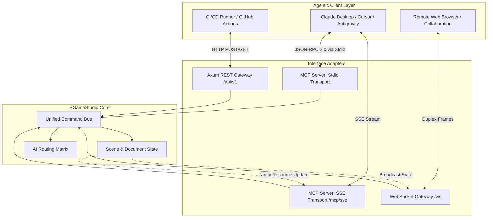

# SGameStudio: MCP & Headless API Specification

## 1. Overview & Protocol Architecture

SGameStudio can be driven identically by human mouse/keyboard inputs, autonomous AI agents, and automated CI/CD pipelines. This is achieved via three standardized programmatic interfaces:

1. **Model Context Protocol (MCP)**: Implements Anthropic's open MCP standard over `stdio` (for desktop agents like Claude Desktop, Cursor, Antigravity) and `Server-Sent Events (SSE)` over HTTP (for network agents).
2. **REST API**: Standard HTTP/JSON endpoints for headless script execution, remote servers, and automation pipelines.
3. **WebSocket Event Gateway**: Real-time duplex communication for live viewport synchronization, timeline scrubbing, and streaming progress of long-running AI tasks.



---

## 2. Model Context Protocol (MCP) Specification

### 2.1 Protocol Transports
- **Stdio Transport**: Launched via `sgame-studio --mcp`. Standard input/output handles JSON-RPC 2.0 messages.
- **SSE Transport**: Launched via `sgame-studio --server --port 8080 --mcp-sse`.
  - SSE Endpoint: `http://127.0.0.1:8080/mcp/sse`
  - Message Post Endpoint: `http://127.0.0.1:8080/mcp/message?sessionId={id}`

### 2.2 MCP Resources
Agents can read live project data directly into context:

| Resource URI | Description | MIME Type |
| :--- | :--- | :--- |
| `sgame://project/summary` | Global project metadata, active target engine, asset counts | `application/json` |
| `sgame://scene/2d/hierarchy` | Complete 2D vector layers, path nodes, 2D bone tree, and weights | `application/json` |
| `sgame://scene/3d/hierarchy` | 3D scene graph, mesh geometries, materials, armature bones | `application/json` |
| `sgame://audio/manifest` | Audio clips manifest, SFX parameters, vocal lines, tracker patterns | `application/json` |
| `sgame://assembler/entity` | Game Asset entity blueprint, collision shapes, audio-anim events | `application/json` |
| `sgame://viewport/screenshot` | Real-time viewport screenshot (Base64 PNG) for vision model review | `image/png` |

---

### 2.3 MCP Tool Catalog & Schemas

Below are the core MCP tools exposed to external AI agents:

#### Category A: Project & Workspace Management

##### `sgame_new_project`
Creates a brand new game asset project.
```json
{
  "name": "sgame_new_project",
  "description": "Initialize a new SGameStudio project with optional starter templates.",
  "parameters": {
    "type": "object",
    "properties": {
      "projectName": { "type": "string", "description": "Name of the project." },
      "targetEngine": { 
        "type": "string", 
        "enum": ["godot4", "unity", "unreal5", "generic_gltf"], 
        "default": "godot4" 
      },
      "template": {
        "type": "string",
        "enum": ["empty", "2d_platformer_character", "3d_action_character", "retro_sfx_pack"],
        "default": "empty"
      }
    },
    "required": ["projectName"]
  }
}
```

##### `sgame_save_project`
Saves the active project to disk.
```json
{
  "name": "sgame_save_project",
  "description": "Save the current project to an .sgsproj bundle.",
  "parameters": {
    "type": "object",
    "properties": {
      "filePath": { "type": "string", "description": "Absolute destination path (.sgsproj)." }
    },
    "required": ["filePath"]
  }
}
```

---

#### Category B: 2D Vector & Rigging Suite

##### `sgame_create_2d_shape`
Adds a new vector shape to the 2D canvas.
```json
{
  "name": "sgame_create_2d_shape",
  "description": "Create a 2D vector shape or custom Bezier path on the 2D canvas.",
  "parameters": {
    "type": "object",
    "properties": {
      "shapeType": { 
        "type": "string", 
        "enum": ["rectangle", "circle", "polygon", "star", "custom_path"] 
      },
      "name": { "type": "string", "description": "Layer/shape identifier." },
      "x": { "type": "number", "description": "Center X coordinate in pixels." },
      "y": { "type": "number", "description": "Center Y coordinate in pixels." },
      "width": { "type": "number" },
      "height": { "type": "number" },
      "svgPathData": { "type": "string", "description": "Required if shapeType is custom_path (SVG d-attribute)." },
      "fillColor": { "type": "string", "description": "Hex or rgba color, e.g. #7c3aed" },
      "strokeColor": { "type": "string", "description": "Stroke color." },
      "strokeWidth": { "type": "number", "default": 2.0 }
    },
    "required": ["shapeType", "name", "x", "y"]
  }
}
```

##### `sgame_boolean_2d_paths`
Performs constructive 2D solid geometry Boolean operations via Skia PathKit WASM.
```json
{
  "name": "sgame_boolean_2d_paths",
  "description": "Execute a 2D Boolean path operation on two vector shapes.",
  "parameters": {
    "type": "object",
    "properties": {
      "shapeA": { "type": "string", "description": "Name or ID of primary shape." },
      "shapeB": { "type": "string", "description": "Name or ID of operand shape." },
      "operation": { 
        "type": "string", 
        "enum": ["union", "difference", "intersection", "xor"] 
      },
      "resultName": { "type": "string", "description": "Name for the resulting compound shape." }
    },
    "required": ["shapeA", "shapeB", "operation", "resultName"]
  }
}
```

##### `sgame_auto_rig_2d`
Runs automatic joint placement and vertex weight generation for a 2D character silhouette.
```json
{
  "name": "sgame_auto_rig_2d",
  "description": "Automatically detect joints and generate a 2D skeletal rig with heat diffusion skinning.",
  "parameters": {
    "type": "object",
    "properties": {
      "targetLayerGroup": { "type": "string", "description": "Name of the 2D layer group containing the character." },
      "rigTopology": { 
        "type": "string", 
        "enum": ["biped_standard", "quadruped", "serpentine", "custom_auto"], 
        "default": "biped_standard" 
      },
      "useAIHeuristic": { 
        "type": "boolean", 
        "description": "Use vision AI model to refine joint centers.",
        "default": true 
      }
    },
    "required": ["targetLayerGroup"]
  }
}
```

---

#### Category C: 3D Modeling & Rigging Suite (Dual-Mode: Dust3D + Wings3D)

##### `sgame_create_node_model`
Generates a 3D creature or character from a hierarchical node tree using the Dust3D engine with inherent auto-rigging.
```json
{
  "name": "sgame_create_node_model",
  "description": "Generate a watertight 3D mesh and inherent skeletal rig from a Dust3D-style node tree.",
  "parameters": {
    "type": "object",
    "properties": {
      "modelName": { "type": "string", "description": "Unique name for the node model." },
      "nodes": {
        "type": "array",
        "items": {
          "type": "object",
          "properties": {
            "id": { "type": "string" },
            "name": { "type": "string" },
            "radius": { "type": "number", "description": "Sphere radius at this node in meters." },
            "position": { 
              "type": "array", 
              "items": { "type": "number" }, 
              "minItems": 3, 
              "maxItems": 3,
              "description": "[x, y, z] coordinates." 
            },
            "parentId": { "type": "string", "description": "Parent node ID (omit for root)." },
            "color": { "type": "string", "description": "Optional hex color, e.g. #3b82f6" }
          },
          "required": ["id", "radius", "position"]
        },
        "description": "Array of 3D joint nodes."
      },
      "symmetry": { "type": "boolean", "default": true, "description": "Mirror along the X-axis." },
      "autoRig": { "type": "boolean", "default": true, "description": "Automatically bind the mesh to the node skeleton." },
      "subdivision": { "type": "integer", "default": 1, "minimum": 0, "maximum": 3 }
    },
    "required": ["modelName", "nodes"]
  }
}
```

##### `sgame_convert_node_model_to_mesh`
Bakes a node-based model into a standard polygon mesh for Wings3D-style editing.
```json
{
  "name": "sgame_convert_node_model_to_mesh",
  "description": "Convert a Dust3D node model into a polygonal mesh for face/edge editing (Extrude, Inset, Bevel).",
  "parameters": {
    "type": "object",
    "properties": {
      "modelName": { "type": "string", "description": "Name of source node model." },
      "targetMeshName": { "type": "string", "description": "Name for resulting polygon mesh." },
      "preserveRig": { "type": "boolean", "default": true, "description": "Retain the inherent skeletal rig." }
    },
    "required": ["modelName", "targetMeshName"]
  }
}
```

##### `sgame_create_3d_primitive`
Creates an initial 3D mesh object in the 3D scene.
```json
{
  "name": "sgame_create_3d_primitive",
  "description": "Create a basic 3D mesh primitive (Wings3D/SketchUp style).",
  "parameters": {
    "type": "object",
    "properties": {
      "primitiveType": { 
        "type": "string", 
        "enum": ["cube", "cylinder", "sphere", "cone", "plane", "torus"] 
      },
      "name": { "type": "string", "description": "Unique name for the mesh." },
      "dimensions": {
        "type": "object",
        "properties": {
          "x": { "type": "number", "default": 1.0 },
          "y": { "type": "number", "default": 1.0 },
          "z": { "type": "number", "default": 1.0 }
        }
      },
      "subdivisions": { "type": "integer", "default": 1 }
    },
    "required": ["primitiveType", "name"]
  }
}
```

##### `sgame_extrude_3d_face`
Performs an extrusion operation on one or more faces.
```json
{
  "name": "sgame_extrude_3d_face",
  "description": "Extrude selected faces along their surface normal or a custom direction vector.",
  "parameters": {
    "type": "object",
    "properties": {
      "meshName": { "type": "string", "description": "Target 3D mesh." },
      "faceIndices": { 
        "type": "array", 
        "items": { "type": "integer" },
        "description": "List of face indices to extrude." 
      },
      "distance": { "type": "number", "description": "Extrusion distance in meters." },
      "individual": { "type": "boolean", "default": false, "description": "Extrude each face individually." }
    },
    "required": ["meshName", "faceIndices", "distance"]
  }
}
```

##### `sgame_auto_rig_3d`
Fits a 3D skeletal armature into a mesh and computes smooth vertex skinning weights.
```json
{
  "name": "sgame_auto_rig_3d",
  "description": "Auto-fit a 3D armature (Humanoid/Quadruped) into a mesh and compute bone skinning weights.",
  "parameters": {
    "type": "object",
    "properties": {
      "meshName": { "type": "string", "description": "Name of the target 3D mesh." },
      "rigTemplate": { 
        "type": "string", 
        "enum": ["humanoid_standard", "quadruped_beast", "flying_creature", "simple_prop"],
        "default": "humanoid_standard" 
      },
      "symmetry": { "type": "boolean", "default": true, "description": "Enforce X-axis mirror symmetry." }
    },
    "required": ["meshName"]
  }
}
```

---

#### Category D: Audio Studio (SFX, Vocals, Music)

##### `sgame_generate_sfx_preset`
Synthesizes a procedural sound effect using the embedded `sfxr` DSP engine.
```json
{
  "name": "sgame_generate_sfx_preset",
  "description": "Generate an instant procedural game sound effect using sfxr parameters.",
  "parameters": {
    "type": "object",
    "properties": {
      "soundName": { "type": "string", "description": "Identifier for the sound effect." },
      "preset": { 
        "type": "string", 
        "enum": ["laser", "explosion", "powerup", "hit", "jump", "coin", "blip", "footstep"] 
      },
      "pitchVariation": { "type": "number", "default": 0.0, "description": "Random pitch variation [-1.0 to 1.0]" }
    },
    "required": ["soundName", "preset"]
  }
}
```

##### `sgame_synthesize_vocal`
Generates voice lines via local neural TTS (Piper/Kokoro) with optional DSP character modulation.
```json
{
  "name": "sgame_synthesize_vocal",
  "description": "Generate character vocal line from text using neural TTS and DSP voice effects.",
  "parameters": {
    "type": "object",
    "properties": {
      "clipName": { "type": "string", "description": "Identifier for the vocal clip." },
      "text": { "type": "string", "description": "Speech text to synthesize." },
      "voiceModel": { "type": "string", "default": "en_US-lessac-medium" },
      "characterEffect": { 
        "type": "string", 
        "enum": ["none", "robot", "monster_growl", "radio_comm", "alien_reverb"], 
        "default": "none" 
      }
    },
    "required": ["clipName", "text"]
  }
}
```

##### `sgame_create_music_pattern`
Adds or modifies a step-sequencer pattern in the tracker music studio.
```json
{
  "name": "sgame_create_music_pattern",
  "description": "Compose a pattern in the audio tracker with notes, instruments, and tempo.",
  "parameters": {
    "type": "object",
    "properties": {
      "trackName": { "type": "string" },
      "bpm": { "type": "integer", "default": 120 },
      "steps": { "type": "integer", "default": 16 },
      "channels": {
        "type": "array",
        "items": {
          "type": "object",
          "properties": {
            "channelIndex": { "type": "integer" },
            "instrument": { "type": "string", "enum": ["synth_lead", "bass", "chiptune_square", "drums"] },
            "notes": { 
              "type": "array", 
              "items": { "type": "string" }, 
              "description": "Array of 16 note strings, e.g. ['C-4', '---', 'E-4', '---', 'G-4']" 
            }
          }
        }
      }
    },
    "required": ["trackName", "channels"]
  }
}
```

---

#### Category E: AI Pipeline Triggers

##### `sgame_ai_prompt_to_asset`
Invokes the configured AI provider to synthesize art, 3D meshes, or audio from natural language.
```json
{
  "name": "sgame_ai_prompt_to_asset",
  "description": "Generate an asset via the configured AI provider pipeline.",
  "parameters": {
    "type": "object",
    "properties": {
      "domain": { 
        "type": "string", 
        "enum": ["2d_vector", "3d_model", "texture_pbr", "audio_sfx", "music_track"] 
      },
      "prompt": { "type": "string", "description": "Detailed generation prompt." },
      "targetName": { "type": "string", "description": "Asset name to assign result." },
      "providerOverride": { "type": "string", "description": "Optional provider override." },
      "modelOverride": { "type": "string", "description": "Optional model override." }
    },
    "required": ["domain", "prompt", "targetName"]
  }
}
```

---

#### Category F: Game Asset Assembler & Multi-Engine Exporter

##### `sgame_assemble_game_entity`
Binds graphics, skeleton, animations, audio events, and collisions into a ready-to-use entity.
```json
{
  "name": "sgame_assemble_game_entity",
  "description": "Assemble components into a unified Game Asset Blueprint.",
  "parameters": {
    "type": "object",
    "properties": {
      "entityName": { "type": "string", "description": "Name of game entity (e.g. KnightHero)." },
      "dimension": { "type": "string", "enum": ["2D", "3D"], "default": "3D" },
      "visualSource": { "type": "string", "description": "Mesh name or 2D layer group name." },
      "animationClips": {
        "type": "array",
        "items": { "type": "string" },
        "description": "List of animation clips to include (e.g. ['Idle', 'Walk', 'Attack', 'Death'])."
      },
      "audioBindings": {
        "type": "array",
        "items": {
          "type": "object",
          "properties": {
            "clipName": { "type": "string" },
            "frame": { "type": "integer" },
            "audioClipName": { "type": "string" }
          },
          "required": ["clipName", "frame", "audioClipName"]
        }
      },
      "collisionShape": {
        "type": "object",
        "properties": {
          "type": { "type": "string", "enum": ["box", "capsule", "sphere", "convex_hull"] },
          "radius": { "type": "number", "default": 0.5 },
          "height": { "type": "number", "default": 1.8 }
        },
        "required": ["type"]
      }
    },
    "required": ["entityName", "visualSource"]
  }
}
```

##### `sgame_export_to_engine`
Exports the assembled entity to a target game engine format.
```json
{
  "name": "sgame_export_to_engine",
  "description": "Export the assembled game asset package to Godot 4, Unity, or Unreal Engine 5.",
  "parameters": {
    "type": "object",
    "properties": {
      "entityName": { "type": "string", "description": "Name of assembled entity." },
      "targetEngine": { "type": "string", "enum": ["godot4", "unity", "unreal5", "gltf_standard"] },
      "outputDirectory": { "type": "string", "description": "Destination directory path on disk." },
      "embedAudio": { "type": "boolean", "default": true },
      "optimizeTextures": { "type": "boolean", "default": true }
    },
    "required": ["entityName", "targetEngine", "outputDirectory"]
  }
}
```

##### `sgame_generate_engine_code`
Generates ready-to-run character controller or gameplay entity code mapped to the blueprint.
```json
{
  "name": "sgame_generate_engine_code",
  "description": "Generate boilerplate character controller or entity script for target game engine and language.",
  "parameters": {
    "type": "object",
    "properties": {
      "entityName": { "type": "string", "description": "Name of the assembled game entity." },
      "targetEngine": { 
        "type": "string", 
        "enum": ["godot4", "unity", "unreal5", "bevy", "raylib", "web_html5", "defold_love2d"] 
      },
      "language": { 
        "type": "string", 
        "enum": ["gdscript", "csharp", "cpp", "rust", "c", "typescript", "lua"] 
      },
      "gameplayStyle": { 
        "type": "string", 
        "enum": ["platformer_2d", "top_down_2d", "third_person_3d", "first_person_3d", "stationary_npc", "custom_prompt"],
        "default": "platformer_2d"
      },
      "customPrompt": {
        "type": "string",
        "description": "Optional instructions for AI-assisted gameplay modifications (e.g. 'Add double jump and stamina wall slide')."
      },
      "outputFilePath": {
        "type": "string",
        "description": "Optional path to automatically write the generated script file."
      }
    },
    "required": ["entityName", "targetEngine", "language"]
  }
}
```

---

## 3. Headless REST API Specification

When running in server mode (`sgame-studio --server --port 8080`), SGameStudio exposes the following REST endpoints:

### Authentication
Include bearer token in HTTP header if configured in `settings.json`:
```http
Authorization: Bearer <STUDIO_API_TOKEN>
```

### Endpoints

#### `POST /api/v1/commands/dispatch`
Execute any atomic command through the Command Bus.
- **Request Body**:
  ```json
  {
    "command": "Create3DPrimitive",
    "payload": {
      "primitiveType": "cube",
      "name": "Knight_Shield",
      "dimensions": { "x": 0.8, "y": 1.2, "z": 0.1 }
    }
  }
  ```
- **Response `200 OK`**:
  ```json
  {
    "status": "success",
    "commandId": "cmd_9481a82f",
    "executionTimeMs": 1.4,
    "result": { "entityId": "Knight_Shield", "vertexCount": 8, "faceCount": 6 }
  }
  ```

#### `GET /api/v1/viewport/render`
Captures the active 2D or 3D viewport canvas.
- **Query Parameters**:
  - `mode`: `2d` | `3d` (defaults to active tab)
  - `width`: `integer` (defaults to 1280)
  - `height`: `integer` (defaults to 720)
  - `cameraAngle`: `front` | `perspective` | `top`
- **Response `200 OK`**: Returns binary image data `image/png` or JSON containing base64 data.

#### `POST /api/v1/project/export`
Trigger automated package build and engine export.
- **Request Body**:
  ```json
  {
    "entityName": "KnightHero",
    "targetEngine": "godot4",
    "outputDir": "/home/user/games/my_godot_game/assets/characters/knight"
  }
  ```
- **Response `200 OK`**:
  ```json
  {
    "status": "completed",
    "filesGenerated": [
      "KnightHero.tscn",
      "KnightHero.glb",
      "sounds/footstep.tres",
      "sounds/sword_slash.tres"
    ],
    "bytesWritten": 418290
  }
  ```

#### `POST /api/v1/assets/generate-code`
Generate ready-to-use controller script for an assembled game entity.
- **Request Body**:
  ```json
  {
    "entityName": "KnightHero",
    "targetEngine": "godot4",
    "language": "gdscript",
    "gameplayStyle": "platformer_2d",
    "customPrompt": "Add coyote time and jump buffering"
  }
  ```
- **Response `200 OK`**:
  ```json
  {
    "status": "success",
    "fileName": "KnightHero.gd",
    "language": "gdscript",
    "code": "extends CharacterBody2D\n\nconst SPEED = 300.0\nconst JUMP_VELOCITY = -400.0\n...",
    "exportedPath": null
  }
  ```

#### `GET /api/v1/health`
Returns service status, GPU hardware accelerator status, and active connections.

---

## 4. WebSocket Event Gateway Specification

Connect to `ws://127.0.0.1:8080/ws`.

### Client $\to$ Server Messages
```json
{
  "type": "subscribe_viewport",
  "fps": 15,
  "viewport": "3d"
}
```

### Server $\to$ Client Broadcast Messages
```json
{
  "event": "ai_task_progress",
  "taskId": "task_pbr_gen_01",
  "progress": 0.65,
  "statusMessage": "Synthesizing Normal and Roughness maps..."
}
```
```json
{
  "event": "scene_mutated",
  "command": "Extrude3DFace",
  "affectedEntities": ["Knight_Shield"]
}
```
